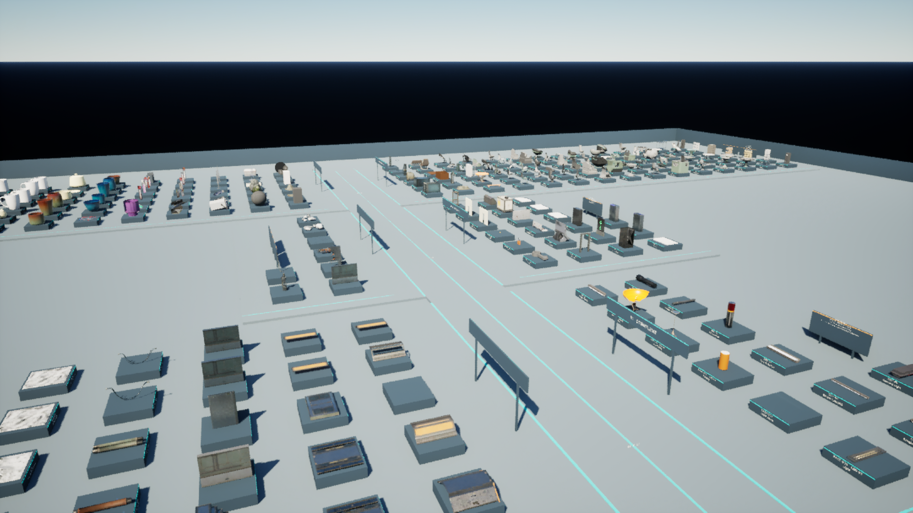
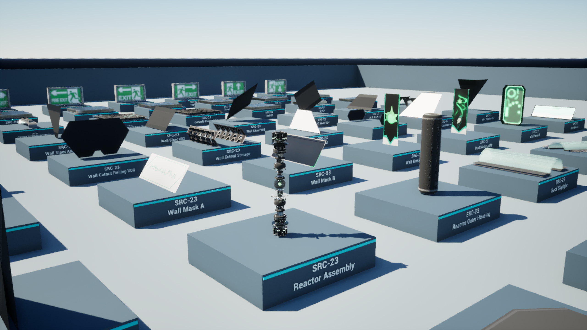
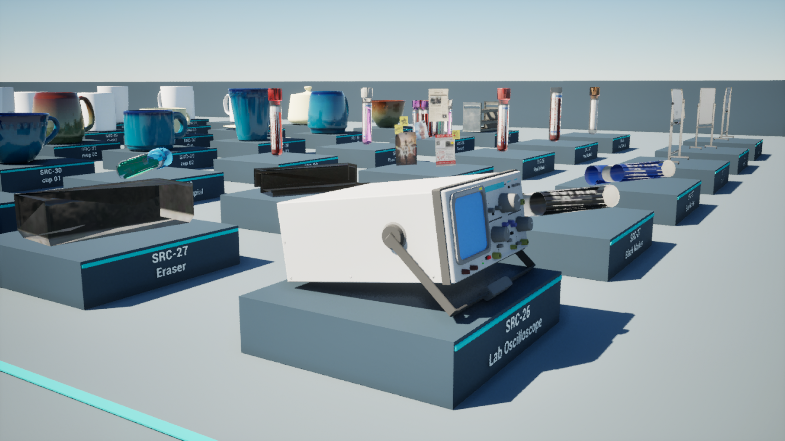
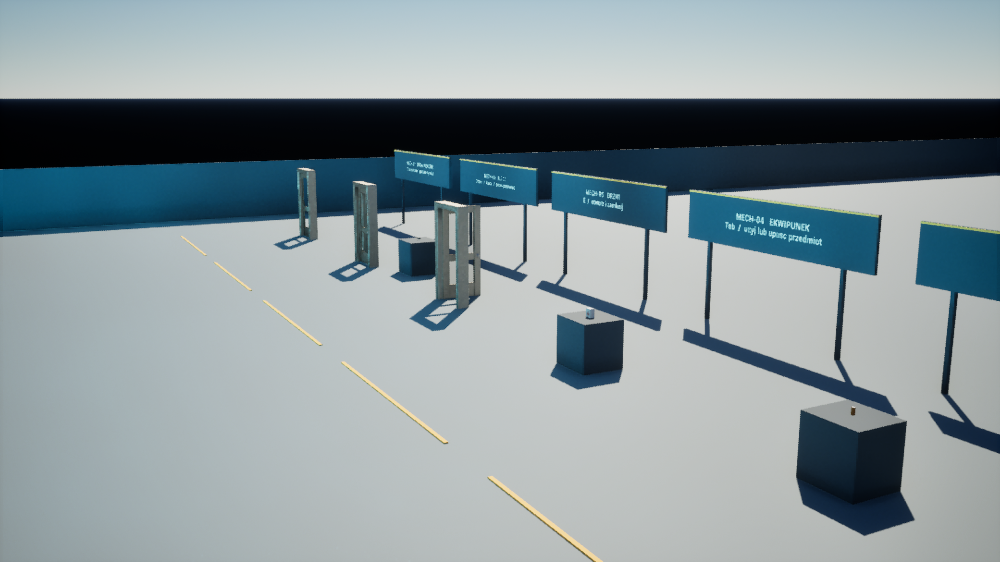
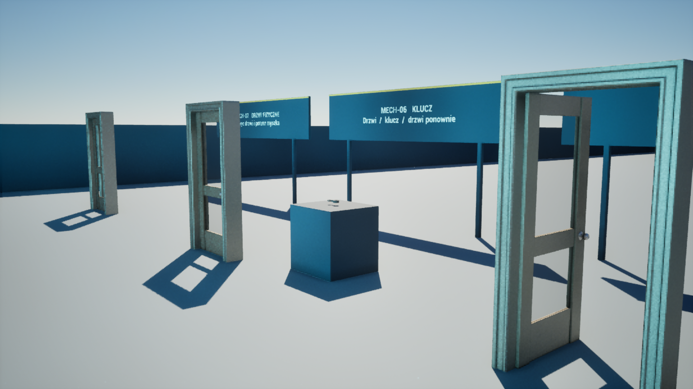
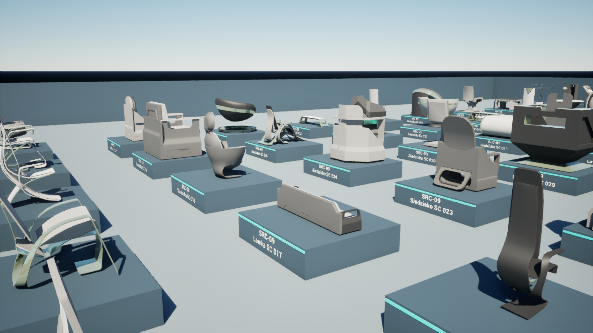

# Escape from Spaceship · raport ze sceny pokazowej

**Unreal Engine 5.8.4 · 561 eksponatów · 14 z 14 mechanik z wynikiem PASS.** W maszynowej kontroli odczytano z zapisanej mapy 114 modeli z projektu wykładowcy i 447 modeli lub wariantów z 42 źródeł. Każda ścieżka siatki ma w galerii osobny egzemplarz i podpis. Testy wykonano 25 listopada 2026 r. w kompilacji 58902052.

Poniższe obserwacje i CSV dokumentują historyczną gałąź `showcase/ue-5.8`. Na gałęzi `gameplay/ldd-ue-5.8` poprawiono m.in. `DropItem`. Upuszczony przedmiot pojawia się na podłodze i można go ponownie podnieść. Drzwi pobierają jeden klucz przy pierwszym otwarciu. [Sterowanie i mechaniki aktualnej wersji](../../README.md#stanowiska-mechanik-z-ldd)

## Uruchomienie i trasa zwiedzania

Otwórz `HorrorProject.uproject` z gałęzi `showcase/ue-5.8` i wybierz **Play**. Startowa mapa to `/Game/StudentShowcase/Maps/L_ModelsAndMechanics_Showcase`. Przed graczem jest turkusowa aleja sześciu działów, za nim hala czternastu stanowisk. Dział konstrukcji ma poszerzone skrzydło na zestaw modułów statku. Podesty oznaczono identyfikatorem BASE lub SRC. Tablice **BRAK MODELU** odnoszą się do pozycji SRC i typów LDD.

WASD i mysz sterują postacią. Shift uruchamia sprint, Ctrl kucanie, E interakcję, F latarkę, a Tab ekwipunek. Przy fizycznych drzwiach przytrzymaj lewy przycisk myszy i porusz myszą. Kombinacja czterech tarcz zamka to **9516**.

Wersję silnika dobrano do sekcji narzędzi w aktualnym dokumencie grupy. Oryginalna mapa `/Game/Maps/Level1` jest dostępna obok sceny pokazowej. Gałąź `main` zachowuje bazę w UE 5.5. [Level Design Document Grupy 2](https://drive.google.com/file/d/1D_hWoKvc8RPVyMT4YRYq2RtOo48hKyNd/view)

## Modele i brakujące źródła

Sprawdzono wszystkie **46** linków z LDD i pobrano pliki z **43** źródeł. W projekcie wykorzystano **42**, w tym 9 pobranych z Fab i 33 ze Sketchfab. Największe zestawy to SRC-23 z 217 modułami i wariantami, SRC-09 z 60 meblami, SRC-40 z 26 znakami ewakuacyjnymi i SRC-24 z 21 płytami podłogowymi. SRC-40 podpisano w dokumencie „Sing”. Oględziny geometrii i tekstur pozwoliły przypisać go do znaków ewakuacyjnych. [Manifest 46 źródeł](01_REFERENCJE_MODELI.csv) · [Autorzy i licencje](CREDITS.md)

| Dział galerii | Modele z bazy | Importowane eksponaty | Głębokość wejścia gracza podczas testu |
|---|---:|---:|---:|
| Oświetlenie | 5 | 9 | 12,16 m |
| Konstrukcja statku | 69 | 281 | 102,60 m |
| Drzwi i interakcje | 7 | 14 | 15,50 m |
| Zagrożenia i zniszczenia | 8 | 0 | 8,81 m |
| Wyposażenie statku | 14 | 72 | 52,36 m |
| Przedmioty i dekoracje | 11 | 71 | 49,01 m |

| Źródło pominięte w scenie | Powód |
|---|---|
| SRC-11 · Hospital Bed | Plik pobrany do lokalnego audytu. Nazwy siatek i wygląd wskazują na model z komercyjnego pakietu KitBash3D Secret Lab. Nie potwierdzono praw do udostępnionej kopii. |
| SRC-20 · zestaw wentylatorów | Płatna oferta. W galerii można obejrzeć wentylację z odrębnego źródła SRC-22. |
| SRC-21 · Poppy Playtime Chapter 2 Walkables Vent | Zawartość pochodzi z gry. Brak potwierdzenia uprawnień publikującego do udzielenia licencji. |
| SRC-37 · plik dokumentów | Opis autora zawiera polecenie „do not use” przy oznaczeniu CC BY. |

Wśród **75 typów LDD** bezpośredni model ma **45**, a dla **8** dalszych wystawiono wystarczający odpowiednik z podanym ograniczeniem. Spośród **22** typów oznaczonych tablicą braków cztery mają również eksponat pokrewny. Dotyczy to sygnalizatora obrotowego, drzwi przesuwnych, bezpieczników i notatnika. [Manifest typów i zakres dopasowań](02_KATEGORIE_Z_DOKUMENTU.csv) · [Inwentarz 114 modeli bazowych](04_ISTNIEJACE_MODELE_W_PROJEKCIE.csv)

| Dział | Typy oznaczone tablicą braków |
|---|---|
| Oświetlenie | włączniki światła (LDD-05), uszkodzone lampy (LDD-06), obrotowe sygnalizatory ostrzegawcze (LDD-10) |
| Konstrukcja statku | korytka kablowe (LDD-23), narożniki korytek kablowych (LDD-24), rozdzielacze chłodziwa (LDD-26), rampy techniczne (LDD-27) |
| Drzwi i interakcje | drzwi przesuwne (LDD-30), dźwignie (LDD-35), bezpieczniki (LDD-36) |
| Zagrożenia i zniszczenia | Dziury w podłodze (LDD-43), przepaście (LDD-44), mechanizmy zgniatające (LDD-45), plamy krwi (LDD-47), ślady pazurów (LDD-48) |
| Wyposażenie statku | Łóżka (LDD-51), beczki (LDD-57), skrzynki narzędziowe (LDD-62), umywalki (LDD-65) |
| Przedmioty i dekoracje | butelki (LDD-68), notatniki (LDD-70), zdjęcia załogi (LDD-71) |

## Testy w Play In Editor

**Oryginalny Level1.** Wejście W przesunęło postać o 149 cm w osi X. F zapalił reflektor, Tab otworzył zwinięty ekwipunek, a interakcja z drzwiami zmieniła ich stan. Interakcja z zamkiem przełączyła kamerę gracza na aktora z czterema tarczami i kombinacją 9–5–1–6.

**Showroom.** Wyniki to **14 PASS, 0 FAIL, 0 NOT TESTED**. Testy sprawdziły ruch i staminę, latarkę i baterię, ekwipunek, trzy rodzaje drzwi, zamek, oba rodzaje światła, zdrowie i leczenie, śmierć i restart, podpowiedzi oraz podnoszenie. Zarejestrowano reakcje na prawdziwe wejście gracza w PIE i efekty kontrolnych wywołań oryginalnych funkcji Blueprintów. Metodę dla każdej próby podaje CSV. W bazowej funkcji `DropItem` przedmiot znika ze slotu. Nowy pickup w świecie gry nie powstaje. [14 stanowisk i obserwacje](03_TESTY_MECHANIK.csv)

**Przejście galerii.** Ten sam gracz ciągłym ruchem WASD osiągnął wszystkie 21 punktów trasy, wszedł do sześciu działów, przeszedł poszerzone skrzydło konstrukcji i dotarł do końca głównej alei. Długość przejścia wyliczona z próbek położenia to około **694 m**. Odcinek alei miał **71,43 m**. W każdym dziale komponent ruchu potwierdził kontakt z jego podłogą.

**Kontrola po zapisie.** Po ponownym otwarciu mapy sprawdzono 561 podpisów oraz położenie i podparcie wszystkich eksponatów. Każda z 447 importowanych siatek ma materiał i prostą kolizję. Podesty mają kolizję z graczem, a wystawione na nich modele można oglądać bez zahaczania postacią o detale. W 902 paczkach galerii wykryto 0 brakujących twardych odwołań do zawartości projektu. Kompilacja Blueprintów zwróciła 0 błędów, 0 ostrzeżeń i 0 plików, których nie udało się załadować.

**Ponowne uruchomienie projektu.** W osobnym procesie UE 5.8.4 otwarto plik projektu bez wskazywania mapy. Edytor załadował showroom, a Play uruchomił oryginalną postać `L1_Character_C`. Świat gry zawierał wszystkie 561 oznaczonych eksponatów. Wtyczka Android File Server była wyłączona, a konfiguracja po tej próbie była wolna od jej wpisu uwierzytelniającego.

## Zmiany w kopii projektu

Dodano oddzielną mapę, sześć działów, stanowiska, oświetlenie, materiały ekspozycji i foldery modeli według kategorii. Skorygowano ścieżki GameMode i GameInstance. Trzy demonstracyjne instancje drzwi korzystają z lokalnej kopii siatki z prostą kolizją. Wczytanie gry po śmierci na mapie pokazowej wraca do tej mapy, a inne poziomy zachowują pierwotny cel restartu. W SRC-12 zastąpiono grafikę programu FL Studio własną grafiką ekranów. Repozytorium zawiera projekt z przypisaną atrybucją. Oryginalne pobrania i dane sesji są poza repozytorium.

## Zrzuty z uruchomionej gry

Sześć ujęć zapisano bezpośrednio z PIE w rozdzielczości 2560 × 1440.

| | |
|---|---|
|  |  |
| Widok z wejścia na główną aleję galerii | Reaktor i moduły konstrukcyjne, w tle oznaczenia ewakuacyjne |
|  |  |
| Oscyloskop laboratoryjny i sąsiednie eksponaty | Stanowiska testów mechanik |
|  |  |
| Drzwi interaktywne i stanowisko klucza | Warianty mebli z zestawu SRC-09 |
