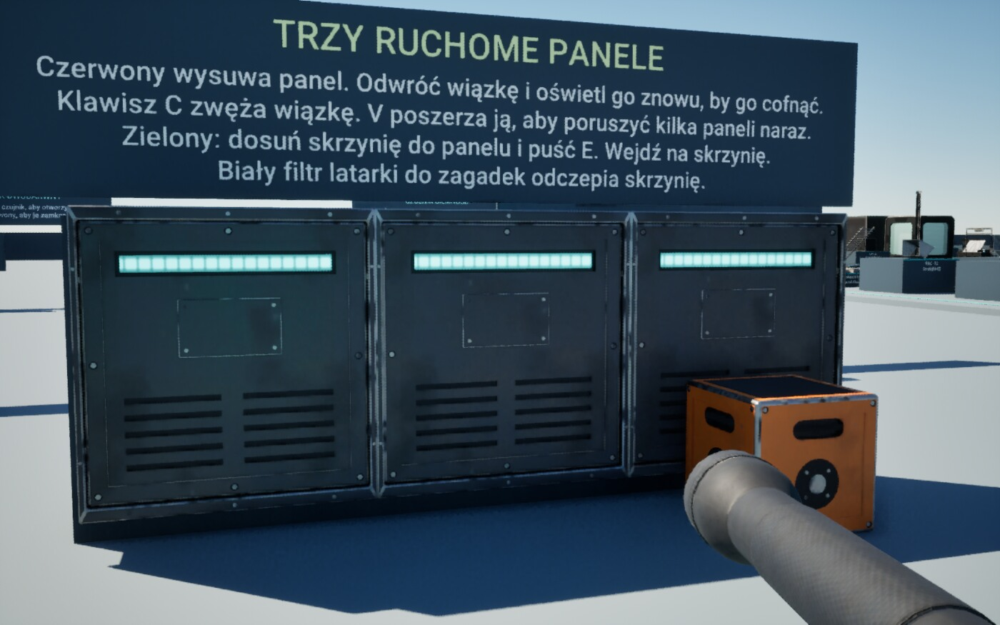
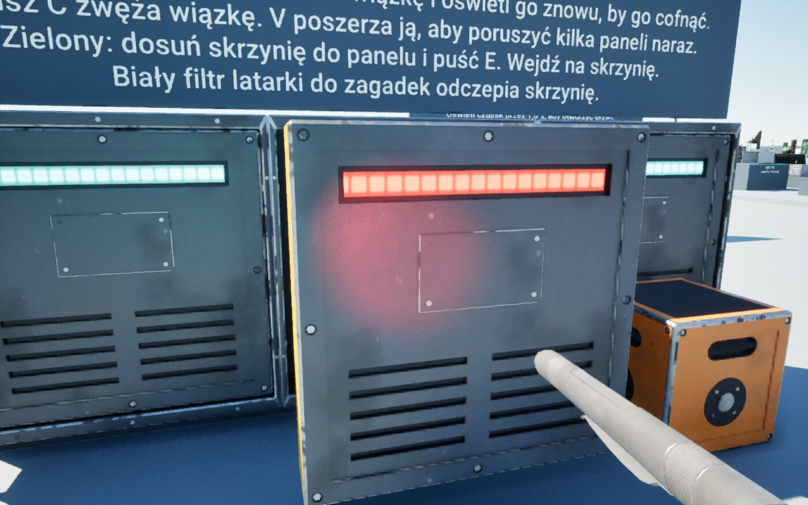
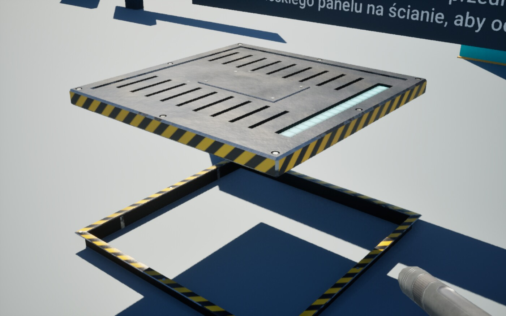
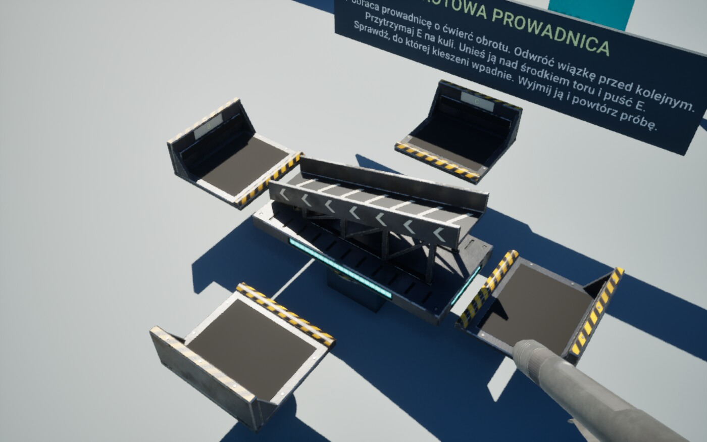
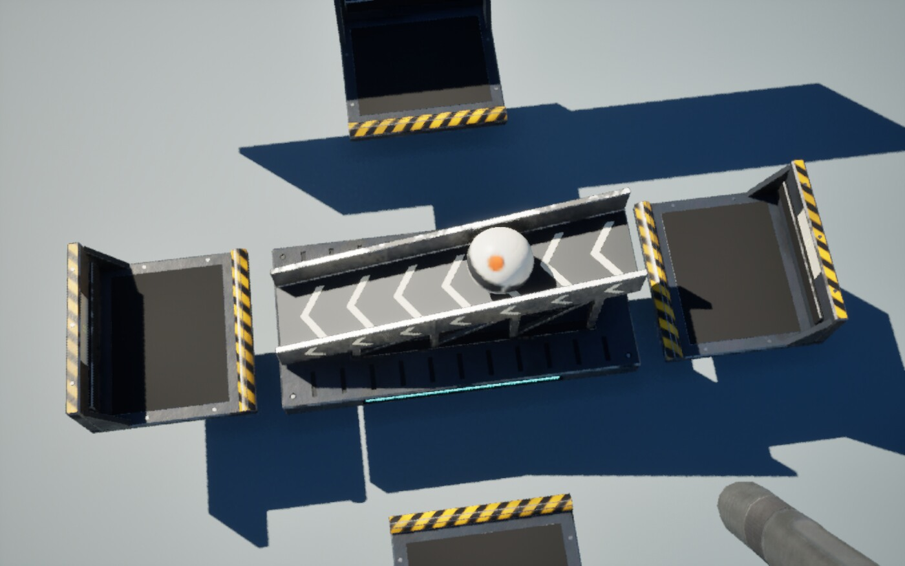
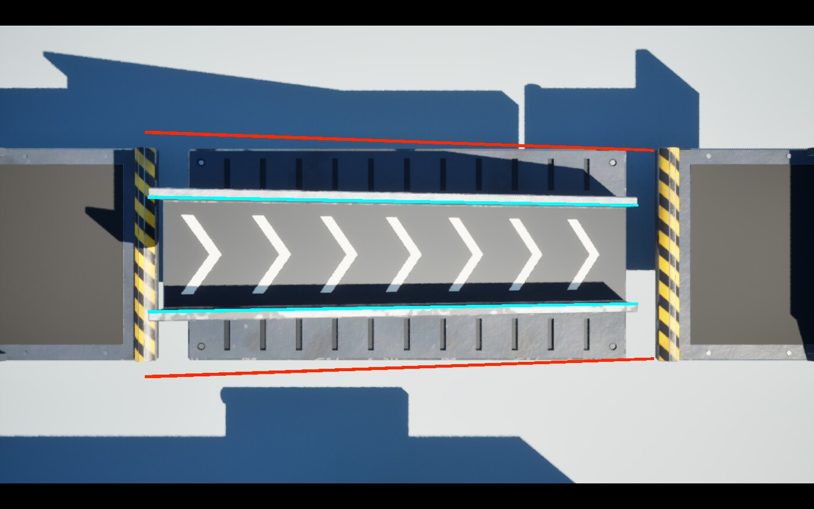

# Modele modułów świetlnych w scenie testowej

W Unreal Engine 5.8.4 otwórz mapę `/Game/StudentShowcase/Maps/L_ModelsAndMechanics_Showcase`. W trybie **Play** weź latarkę zagadkową przy stole, wybierz ją pod **Tab** i włącz klawiszem **F**. Za płytami naciskowymi skręć w prawo. **Q** przełącza filtr. Czerwony wysuwa panel, fioletowy obraca prowadnicę, zielony mocuje skrzynię, biały ją zwalnia, a niebieski wybija gracza lub przedmiot.

## Co trafiło do projektu

W Content Browser otwórz `Content/StatekFPP`. Folder `Meshes` zawiera dziewięć siatek, `Textures` dziesięć tekstur, a `Materials` materiał bazowy PBR, pięć instancji, trzy materiały o stałych parametrach oraz `M_Indicator`. Sloty materiałów odpowiadają nazwom z FBX. Tekstury ORM używają kanałów R/G/B dla AO, szorstkości i metaliczności. Normalna ma konwencję DirectX. Siatki zaimportowano w centymetrach z oryginalnymi normalnymi i wygenerowanym drugim kanałem UV.

| Aktory na mapie | Podpięcie modelu i wynik testu |
|---|---|
| `LAB-MODULE-WALL-A/B/C` | Lico porusza się z `Carriage`, a rama pozostaje przy `Mount`. Każde lico ma 26 × 132 × 134 cm. Rozstaw osi wynosi 140 cm. Środkowy blok przesunął się o 92 cm prostopadle do ściany. Po schowaniu jego front i płaszczyzna montażu ramy wypadają na lokalnym X = +13 cm. Detal kołnierza sięga 3,05 cm przed tę płaszczyznę. |
| `LAB-MODULE-FLOOR` | Płyta 10 × 156 × 156 cm przesunęła się o 100 cm pionowo, rama o 0 cm. Lokalna +X aktora wskazuje w górę. |
| `LAB-MODULE-GUIDE` | Rotor jest dzieckiem `Carriage`. Pochylenie toru zawiera już FBX. Wspornik jest dzieckiem nieruchomego `Mount`. Podstawa rotora ma 16 × 220 × 106 cm w lokalnym XYZ. Po naświetleniu fioletowym wylot obrócił się o 90° z kieszeni A na B, zgodnie z fizycznym torem. |
| Kieszenie A–D | Cztery siatki przy nieruchomej podstawie prowadnicy. Pivot każdej leży o 4,14 cm powyżej osi i 175 cm od niej w rzucie poziomym. Litery A–D znajdują się na tylnych ogranicznikach. Przy promieniu obrotu 121,59 cm zostaje 3,41 cm do najbliższej kieszeni. |
| `LAB-MODULE-CRATE-A/B` i `LAB-MODULE-BALL` | Nowe siatki poruszają się z dotychczasowymi bryłami fizycznymi. Skrzynie mają po 72 × 72 × 72 cm i 38 kg. Kula ma średnicę 38 cm i masę 6 kg. Podczas toczenia środki siatki i fizycznej kuli pokrywały się. |

Funkcja `AShipLightModule::SetIndicatorColor(LinearColor, Intensity)` steruje parametrami materiału dynamicznego w slocie `Indicator`. Wywołuje ją istniejące `ApplyColor` po zmianie filtra i po odsunięciu wiązki. W PIE przełączono wszystkie pięć filtrów klawiszem Q. Wskaźnik przyjął każde zadane RGB, a po wyłączeniu latarki wrócił do turkusowego koloru spoczynkowego. Wszystkie 39 kontroli istniejących mechanik modułów również przeszło.

## Różnice między modelem a kolizją

Porównanie zapisanych pozycji, rozmiarów, profili i ustawień fizyki wszystkich 33 aktywnych komponentów stanowisk dało ten sam wynik przed integracją i po niej. Wszystkie 17 nowych komponentów wizualnych ma wyłączoną kolizję. Kierunek osi zgadza się z FBX.

| Miejsce | Pomiar i skutek w grze |
|---|---|
| Burty prowadnicy | Model daje **46 cm** prześwitu, fizyczne burty **98 cm**. Różnica to **26 cm na stronę**. Kula Ø 38 cm ma w widocznym torze 4 cm luzu na stronę. Przy ruchu na bok może częściowo przeniknąć przez widoczną burtę. |
| Pochylnia | Na środku widoczne dno leży na wysokości 44,08 cm względem osi prowadnicy, fizyczna powierzchnia na 45,06 cm. Kula toczy się około 0,98 cm nad widocznym dnem. |
| Kieszenie A–D | Środki widocznych den są o 14 cm dalej od osi niż środki fizycznych den. Wierzch widocznej maty jest o **75,54 cm** wyżej od fizycznego dna, próg o 62,14 cm wyżej od fizycznego progu, a najwyższy detal ogranicznika o 30,69 cm wyżej od fizycznego ogranicznika. W próbie kula przetoczyła się do kieszeni B i zatrzymała środkiem na Z = 10 cm, poniżej widocznej maty. |
| Płyta i wspornik | Schowana płyta pokrywa się ze swoim boxem. Jej górna powierzchnia leży 10 cm nad pokładem sceny. Spód modelu wspornika leży 46 cm nad pokładem, w miejscu istniejącego podestu. |

## Zrzuty z gry

| Panele schowane | Środkowy panel wysunięty |
|---|---|
|  |  |

| Podniesiona płyta | Prowadnica po obrocie |
|---|---|
|  |  |

Na ujęciu diagnostycznym turkusowe linie zaznaczają wewnętrzne krawędzie modelu oddalone o 46 cm. Pomarańczowe linie pokazują wewnętrzne krawędzie kolizji oddalone o 98 cm.

## Powtórzenie importu i testu

Zbuduj moduł edytora dla UE 5.8.4. W konsoli Python edytora uruchom skrypt importu z katalogu `Scripts`. Domyślnie odczytuje `Documents/StatekFPP_Moduly` użytkownika. Ścieżkę można podać przez zmienną środowiskową `STATEK_SOURCE`. Skrypt weryfikuje istniejące pakiety i tworzy brakujące. Następnie, z otwartą sceną testową, uruchom skrypt podpinający modele, jeśli odtwarzasz układ sceny. Projekt pobrany z GitHuba zawiera już zaimportowane modele i zapisane stanowiska. [Skrypt importu](../../../Scripts/import_statek.py) · [Podpięcie do sceny](../../../Scripts/setup_statek_scene.py)

Test uruchamia grę w edytorze, przełącza filtry, mierzy ruch i zapisuje ujęcia z renderera Unreal. Polecenie uruchomienia jest na początku skryptu. [Skrypt weryfikacji](../../../Scripts/verify_statek.py) · [Pomiary z PIE](pomiary-pie.json)
